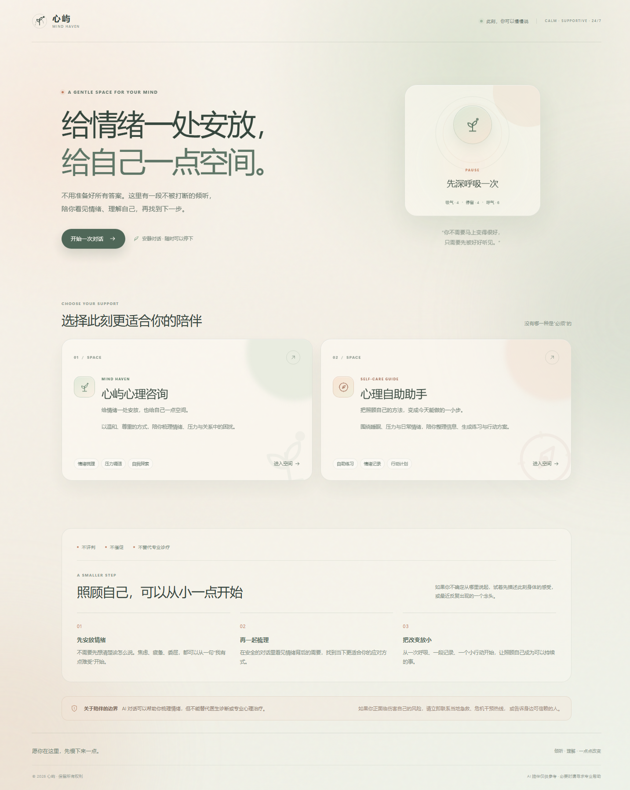
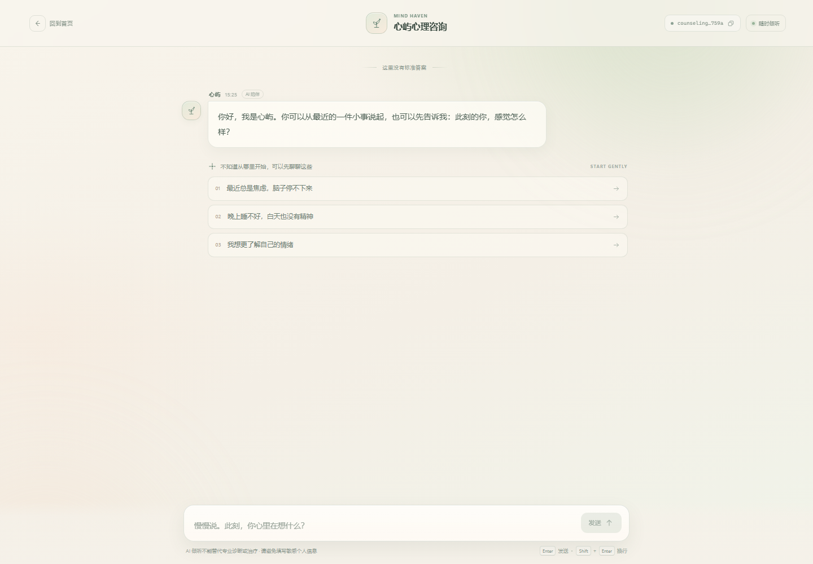
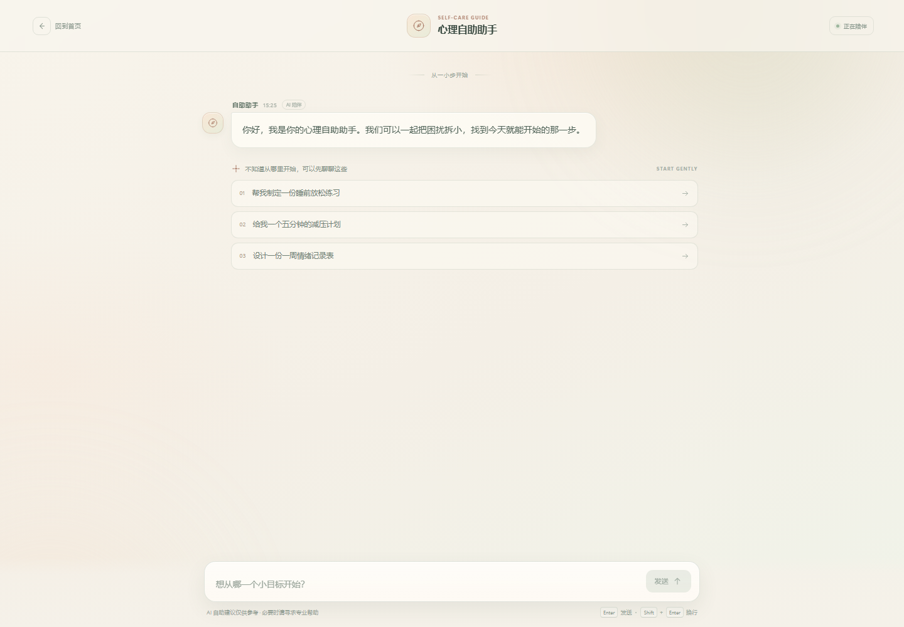

# 心屿 · 心理咨询 AI 前端

基于 **Vue 3 + Vite + Vue Router + Axios** 的心理咨询对话前端，包含：

- **首页**：以温暖、低刺激的视觉呈现心理咨询空间与心理自助入口
- **心屿心理咨询**：进入页面自动生成会话编号，通过 SSE 实时接收陪伴式回应
- **心理自助助手**：围绕睡眠、压力、日常情绪，制定可执行的自助练习
- 用户消息在右、AI 消息在左，支持流式打字效果、暂停回应、错误提示、会话编号复制和快捷提问
- **边界提示**：明确 AI 陪伴不能替代医生诊断或专业心理治疗，并展示危机情况下的求助提醒

## 界面预览

当前页面已切换为暖米色、鼠尾草绿与陶土色的放松色调。

### 应用首页



### 心屿心理咨询



### 心理自助助手



也可在本地启动后查看：

- 首页：`http://localhost:5173/`
- 心理咨询：`http://localhost:5173/counseling`
- 心理自助：`http://localhost:5173/assistant`

## 快速开始

```bash
npm install
npm run dev
```

浏览器打开 `http://localhost:5173`。

启动前请确认 Spring Boot 后端已运行在 `http://localhost:8123`，接口前缀为 `/api`。

## 后端接口

前端调用地址：

| 应用 | 方法 | 接口 |
| --- | --- | --- |
| 心屿心理咨询 | GET | `/api/ai/counseling_app/chat/sse?message={message}&chatId={chatId}` |
| 心理自助助手 | GET | `/api/ai/super_manus/chat?message={message}` |

开发环境下，Vite 已配置代理：

```text
/api/ai/...  ->  http://localhost:8123/api/ai/...
```

代理目标可以通过 `.env.development` 中的 `VITE_DEV_PROXY_TARGET` 修改，默认是 `http://localhost:8123`。代理配置位于 `vite.config.js`，不会重写路径，因为后端的接口前缀本身就是 `/api`。

## 环境变量与跨域

前端不会直接跨域访问后端，开发和线上都走同源代理：

| 环境 | 环境文件 | `VITE_API_BASE_URL` | 实际链路 |
| --- | --- | --- | --- |
| 开发 | `.env.development` | `/api` | 浏览器 → Vite 代理 → `http://localhost:8123` |
| 生产 | `.env.production` | `/api` | 浏览器 → Nginx 反代 → `BACKEND_UPSTREAM` |

- `VITE_API_BASE_URL` 是 **Vite 构建时变量**，修改后需要重新构建镜像。
- 生产环境保持 `/api` 相对路径，Nginx 会把 `/api/` 转发到后端，因此浏览器看到的前后端同源，不需要 CORS。
- 只有前后端必须分域名部署时，才把 `VITE_API_BASE_URL` 改成完整地址（如 `https://api.example.com/api`），此时需要后端自行允许跨域。

## 部署到微信云托管

前端使用 Nginx 托管静态文件，并把 `/api/` 反向代理到后端。部署相关文件：

- `Dockerfile`：多阶段构建，Node 构建 + Nginx 运行
- `nginx.conf`：Nginx 配置模板，包含 SPA 回退、静态缓存和 SSE 反代
- `.dockerignore`：排除 `node_modules`、`dist`、文档等无用文件

> 如果后端还没部署，先在**同一个环境**里部署后端服务：端口 `8123`，健康检查 `/api/health`，必填环境变量 `DASHSCOPE_API_KEY`。后端部署成功并拿到内网访问地址后，再部署前端。

### 1. 确认后端内网地址

在微信云托管控制台查看后端服务的内网访问地址，例如：

```text
http://super-ai-backend:8123
```

`Dockerfile` 里的默认值 `http://backend:8123` 只是占位，部署时必须改成实际的服务名或内网地址。地址不要以 `/` 结尾，否则 `/api/` 前缀会被替换掉。

### 2. 创建前端服务

在微信云托管控制台新建服务时按下面配置：

| 配置项 | 值 |
| --- | --- |
| 代码目录 | `super-ai-agent-frontend` |
| 构建方式 | Dockerfile |
| 容器端口 | `80` |
| 健康检查路径 | `/healthz` |
| 环境变量 | `BACKEND_UPSTREAM=http://后端服务名:8123` |

`nginx.conf` 会由官方 Nginx 镜像在容器启动时用 `envsubst` 渲染，`BACKEND_UPSTREAM` 修改后重启服务即可生效，不需要重新构建镜像。

### 3. 本地验证镜像

```bash
docker build -t super-ai-frontend .
docker run --rm -p 8080:80 \
  -e BACKEND_UPSTREAM=http://host.docker.internal:8123 \
  super-ai-frontend
```

打开 `http://localhost:8080`。Windows/macOS 的 Docker Desktop 可以用 `host.docker.internal` 访问宿主机上的后端；Linux 可改用宿主机局域网 IP。

### 4. Nginx 关键配置

- `location /api/`：反向代理到 `BACKEND_UPSTREAM`，浏览器同源请求
- `proxy_buffering off`、`proxy_cache off`、长超时：保证 SSE 实时流式返回
- `try_files $uri $uri/ /index.html`：支持 Vue Router history 模式
- `/assets/` 长缓存，`index.html` 不缓存：发版后立即生效

## SSE 实现说明

咨询接口返回 `text/event-stream`。项目没有使用原生 `EventSource`，而是使用 **Axios** 完成流式请求：

1. Axios 指定 `adapter: 'fetch'`、`responseType: 'stream'`；
2. 通过 `response.data.getReader()` 持续读取响应体；
3. 自定义增量 SSE 解析器处理 `data:`、多行数据、心跳注释和跨网络分片的粘包/拆包；
4. 每收到一段内容就更新对应 AI 消息，实现实时打字效果；
5. 通过 `AbortController` 支持暂停回应。

核心代码位于：

- `src/services/sse.js`：Axios 流式请求与 SSE 解析
- `src/services/http.js`：Axios 实例与接口前缀
- `src/views/ChatView.vue`：会话状态、消息发送、自动滚动与错误处理

## 会话编号

进入心屿心理咨询页面时，`src/utils/chat.js` 中的 `createChatId()` 会生成 `counseling-{uuid}` 形式的会话编号，并作为 `chatId` 参数随每次请求发送。顶部会话标签支持点击复制。刷新或重新进入页面会创建新的会话。

## 项目结构

```text
.
├─ Dockerfile              # 多阶段构建：Node 构建 + Nginx 运行
├─ nginx.conf              # Nginx 配置模板（API 反代、SSE、SPA 回退）
├─ .dockerignore           # Docker 构建上下文排除项
├─ .env.development        # 开发环境变量
├─ .env.production         # 生产环境变量
├─ src/
│  ├─ components/
│  │  ├─ AppIcon.vue         # 心理咨询与自助空间图标
│  │  ├─ AppLogo.vue         # 心屿品牌标识
│  │  ├─ ChatComposer.vue    # 输入框、快捷键、暂停按钮
│  │  └─ ChatMessage.vue     # 左右消息气泡、流式状态
│  ├─ config/apps.js         # 服务配置、接口地址、欢迎语、推荐话题
│  ├─ router/index.js        # 首页与两个对话页面路由
│  ├─ services/
│  │  ├─ http.js             # Axios 实例与 API 基础 URL
│  │  └─ sse.js              # SSE 流式客户端
│  ├─ styles/base.css        # 全局样式与浅色主题变量
│  ├─ utils/chat.js          # 会话编号、时间、错误与复制工具
│  └─ views/
│     ├─ HomeView.vue        # 心理咨询空间首页
│     └─ ChatView.vue        # 两个空间共用的对话页
```

## 构建

```bash
npm run build
npm run preview
```

构建时读取 `.env.production`，默认把 `VITE_API_BASE_URL` 注入为 `/api`。构建产物输出到 `dist/`。

`npm run preview` 同样会把 `/api` 代理到 `VITE_DEV_PROXY_TARGET`，方便不启动 Nginx 时本地联调。

## 交互说明

- `Enter` 发送，`Shift + Enter` 换行，兼容中文输入法组合输入
- 回应过程中可以点击「暂停」中断
- 聊天内容接近底部时自动跟随滚动；向上翻阅历史消息时不会被强制拉回
- 移动端适配 320px 及以上宽度
- AI 回应仅供参考；出现自伤、伤人风险时，应优先联系当地急救、危机干预热线或可信赖的人
